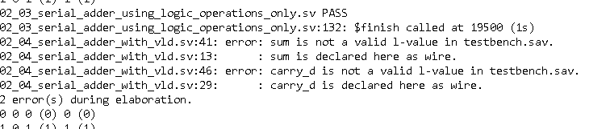
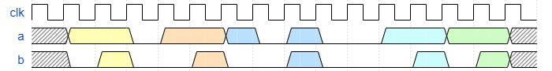
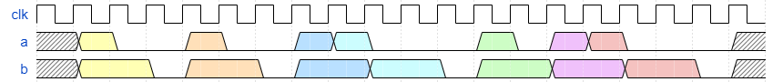
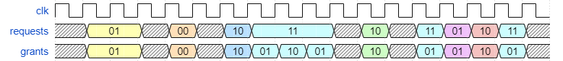
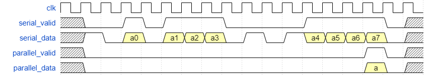

# Задачи домашнего задания 02

## 01_edge_and_pulse_detection

Напишите детектор однотактового сигнала (010).

Для формата вывода посмотрите
`$display` в файле `testbench.sv`.

## 02_single_and_double_rate_fibonacci

Сделайте модуль, который генерирует 2 числа Фибоначчи за такт.

## 03_serial_adder_using_logic_operations_only

Напишите последовательный сумматор, используя только операторы `^` (XOR), `|` (OR),
`&` (AND) и `~` (NOT).

Информацию про однобитный полный сумматор можно найти в книге Харрис и Харрис
или на [Википедии](https://en.wikipedia.org/wiki/Adder_(electronics)#Full_adder).

Для формата вывода посмотрите
`$display` в файле `testbench.sv`.

## 04_serial_adder_with_vld

Напишите модуль, реализующий последовательное сложение двух чисел (сложение
одной пары бит за такт). У модуля есть входы `a` и `b`, выход `sum`.
Также, у модуля есть контрольные сигналы `vld` и `last`.

Сигнал `vld` означает, что входные сигналы являются валидными. Сигнал `last`
означает, что получены последние биты чисел.

Когда `vld` в 1, модуль должен сложить `a` и `b` и выдать сумму `sum`.
Когда `last` в 1, модуль должен выдать сумму и сбросить свое состояние на
начальное, но только если сигнал `vld` тоже в 1, иначе `last` должен игнорироваться.

Когда `rst` в 1, модуль долен сбросить свое состояние на начальное.

sum is not a valid l-value. После исправления, в коде не участвует vld, но проходит тест, можно расширить проверку для определения ошибки.  
Сумматор надо брать из предыдущего задания, в этом решении взят готовый, сильно отличается от предыдущего. Этот код реализует серийный сложитель с предвычислением переноса (P/Gлогика). 
Проходит. Но вернемся к первому решению, разделим регистры.    

## 05_serial_comparator_most_significant_first

Напишите модуль, который последовательно сравнивает 2 числа.

Входы модуля `a` и `b` - это биты от двух чисел, причем старшие биты идут первыми.
Выходы модуля `a_less_b`, `a_eq_b` и `a_greater_b` должны показывать отношение между
`a` и `b`.
Модуль также должен использовать входы `clk` и `rst`.

Для формата вывода посмотрите
`$display` в файле `testbench.sv`.

## 06_serial_comparator_most_significant_first_using_fsm

Напишите последовательный компаратор, аналогичный предыдущему упражнению, но
используя конечный автомат для определения выходов.
Старшие биты приходят первыми.

## 07_halve_tokens

Задание:
Реализуйте последовательный модуль, который вдвое сократит количество входящих токенов "1" (логических единиц).

Временная диаграмма:

In=56 0011_1000 Out=22 0001_0110    

## 08_double_tokens

Задание:
Реализуйте последовательный модуль, который удваивает каждый входящий токен "1" (логическую единицу).
Модуль должен обрабатывать удвоение как минимум для 200 токенов "1", поступающих подряд.

В случае, если модуль обнаруживает более 200 последовательных токенов "1", он должен выставить
флаг ошибки переполнения. Ошибка переполнения должна быть фиксированной (sticky). Как только ошибка появится,
единственный способ устранить ее - использовать сигнал сброса "rst".

Временная диаграмма:

FAIL 02_08_double_tokens/testbench.sv   
++ INPUT =\> {n_orig_tokens:29} 00011101  
++ TEST =\> {n_double_tokens:21} 00010101    

FAIL 02_08_double_tokens/testbench.sv  
++ INPUT =\> {n_orig_tokens:29} 00011101    
++ TEST =\> {n_double_tokens:}  000100101011  
В проверке не все единицы на выходе, хотя присвоил 1. Правильно так.  
02_08_double_tokens.sv #L4  
https://github.com/Emptea/systemverilog-homework/blob/61bd3dea2b9af22c4e5293fc89cfee8d15e393e5/02_sequential_basics/02_08_double_tokens/  

## 09_round_robin_arbiter_with_2_requests

Задание:
Реализуйте модуль "арбитр", который принимает до двух запросов
и предоставляет разрешение на работу (grant) одному из них.

Модуль должен поддерживать внутренний реестр, который отслеживает,
кто из запрашивающих следующий в очереди на получение гранта.

Временная диаграмма:

## 10_serial_to_parallel

Задание:
Реализуйте модуль, который преобразует последовательные данные
в параллельное многоразрядное значение.

Модуль должен принимать одноразрядные значения с "valid" интерфейсом последовательным образом.
После накопления битов ширины модуль должен выставить сигнал "parallel_valid"
и выставить данные.

Временная диаграмма:

еще добавил обратное преобразование parallel_to_serial   